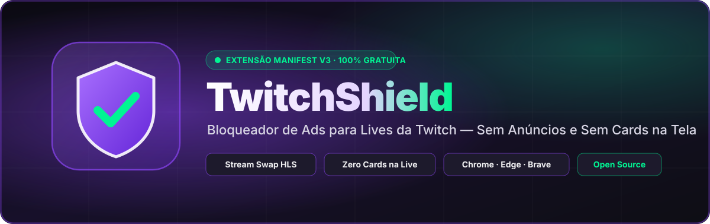

<div align="center">



<br />

# 🛡️ TwitchShield — Bloqueador de Ads para Lives da Twitch

**Assista lives na Twitch sem anúncios pre-roll, sem mid-roll, sem banners e sem nenhum card em cima do vídeo.**  
Extensão pronta para instalar no **Google Chrome, Microsoft Edge, Brave, Opera e Vivaldi** (Manifest V3).

<p>
  <a href="https://github.com/ogerrva/twitch-adblock/releases/latest">
    
  </a>
  <a href="https://ogerrva.github.io/twitch-adblock/">
    
  </a>
</p>

<p>
  
  
  
  
</p>

</div>

---

## ⚡ Instalação Rápida no Navegador (30 segundos)

Você **não precisa saber programar** nem instalar nada no computador. Basta carregar a pasta da extensão no navegador:

1. **[Clique aqui para baixar o `TwitchShield-v1.1.0.zip`](https://github.com/ogerrva/twitch-adblock/releases/latest)** *(ou clique em `Code` → `Download ZIP` no topo desta página)*.
2. **Extraia** o arquivo `.zip` em uma pasta fixa no seu computador (ex.: `Documentos\TwitchShield`).
3. Abra a página de extensões do seu navegador:
   - **Google Chrome:** digite `chrome://extensions` na barra de endereços
   - **Microsoft Edge:** digite `edge://extensions`
   - **Brave:** digite `brave://extensions`
   - **Opera / Opera GX:** digite `opera://extensions`
4. Ative a chave **Modo do desenvolvedor** (*Developer mode*) no canto superior direito.
5. Clique em **Carregar sem compactação** (*Load unpacked*) e selecione a pasta extraída onde está o arquivo `manifest.json`.
6. **Pronto!** Fixe o ícone do **TwitchShield** na barra do navegador e recarregue a Twitch (`F5`).

---

## 🚀 Por que o TwitchShield funciona onde bloqueadores comuns falham?

A Twitch não carrega comerciais como arquivos separados — ela costura os anúncios **diretamente dentro do stream de vídeo HLS (`.m3u8`)** no servidor (*Server-Side Ad Insertion — SSAI*). Por isso, bloqueadores tradicionais deixam os comerciais passarem ou travam o player.

O **TwitchShield** usa um motor de bloqueio em **3 camadas**:

| Recurso | TwitchShield | Bloqueadores Comuns |
| :--- | :---: | :---: |
| **Troca paralela de stream HLS (`Stream Swap`)** em < 300ms | ✅ Sim | ❌ Não |
| **Injeção direta no Blob do Worker Amazon IVS** (zero race condition) | ✅ Sim | ❌ Falha com frequência |
| **Remoção de segmentos de anúncio (`stripAdSegments`)** | ✅ Sim | ❌ Não |
| **Requisições reserva anônimas (`credentials: omit`)** em 8 perfis | ✅ Sim | ❌ Não |
| **Zero cards, zero blur e zero popups sobre o vídeo da live** | ✅ Live 100% limpa | ⚠️ Costuma exibir tela preta/aviso |
| **Bloqueio de banners, overlays e rastreadores (DNR)** | ✅ Sim | ✅ Parcial |
| **Lista Branca por canal (1 clique para apoiar streamers)** | ✅ Sim | ⚠️ Manual |
| **100% local, sem servidores externos e sem telemetria** | ✅ Sim | ⚠️ Alguns usam proxies de terceiros |

---

## 🧠 Como funciona por dentro

1. **Motor HLS v2 (`MAIN` world — `src/content/injector.js`)**
   - Intercepta `URL.createObjectURL` + `window.Worker` no `document_start` e acopla o motor diretamente no `Blob` do player Amazon IVS.
   - Monitora todas as playlists `.m3u8` em busca de marcadores SSAI (`stitched-ad`, `twitch-stitched-ad`, `#EXTINF:...,Amazon`, `SCTE35-OUT`).
   - Quando um anúncio é detectado, dispara em **paralelo** requisições anônimas (sem cookies e sem `X-Device-Id`) em 8 perfis alternativos (`embed`, `popout`, `autoplay`, `picture-by-picture`, `site/ios`, `site/android`, `frontpage`, `thunderdome`) com fallback inteligente de resolução (`1080p/720p → 480p → 360p`) e retorna automaticamente à qualidade máxima assim que o intervalo termina.
   - Remove tags de anúncio e segmentos `#EXTINF:...,Amazon` / `#EXT-X-TWITCH-PREFETCH` via `stripAdSegments`.
2. **Bloqueio de Rede (`declarativeNetRequest` — `rules/ad_rules.json`)**
   - Bloqueia nativamente domínios de display ads e telemetria comercial (`amazon-adsystem.com`, `imasdk.googleapis.com`, `doubleclick.net`, `edge.ads.twitch.tv`, `ad.twitch.tv`, etc.).
3. **Limpeza Visual + Painel Popup (`src/content/cosmetic.css` & `src/popup/`)**
   - Oculta banners de display e anúncios laterais sem colocar **nenhum card ou aviso** por cima da transmissão.
   - Popup escuro estilo Twitch com contadores (por live e total), escolha de modo, **Lista Branca** de canais e **Logs** em tempo real.

---

## ❓ Perguntas Frequentes (FAQ)

### Como tirar anúncios das lives na Twitch de graça?
Basta instalar o **TwitchShield** seguindo o passo a passo acima. Ele é 100% gratuito, código aberto (MIT) e não exige assinatura nem conta.

### A extensão coloca algum card ou tela preta em cima da live?
**Não.** O TwitchShield não exibe nenhum card, blur, selo ou overlay sobre o player de vídeo. O objetivo é manter a transmissão limpa e contínua.

### Funciona no Google Chrome, Edge, Brave e Opera GX?
Sim! A extensão foi construída no padrão **Manifest V3**, compatível com todos os navegadores baseados em Chromium (Chrome 111+, Edge, Brave, Opera, Opera GX e Vivaldi).

### Posso liberar anúncios em canais de streamers que eu quero apoiar?
Sim. Abra a live do streamer, clique no ícone do **TwitchShield** e pressione **Permitir ads aqui** (ou gerencie todos na aba **Lista Branca**).

### É seguro? Coleta meus dados ou minha conta da Twitch?
**100% seguro e local.** Todo o código-fonte está aberto neste repositório para auditoria. A extensão não envia nenhum dado para servidores externos, não acessa sua senha nem modifica sua conta da Twitch.

---

## 📁 Estrutura do Projeto

```text
twitch-adblock/
├── manifest.json                  # Manifesto Manifest V3 (pronto para carregar no navegador)
├── rules/
│   └── ad_rules.json              # Regras declarativeNetRequest (display ads e trackers)
├── assets/
│   ├── banner.svg                 # Banner do repositório
│   └── icons/                     # Ícones PNG (16, 48, 128)
├── src/
│   ├── background/
│   │   └── service-worker.js      # Configurações, estatísticas, logs, DNR e badges
│   ├── content/
│   │   ├── injector.js            # Motor HLS v2 (Blob hook + Stream Swap paralelo + stripAdSegments)
│   │   ├── bridge.js              # Sincronização de config e filtros DOM
│   │   └── cosmetic.css           # Ocultação de banners externos (sem overlays na live)
│   └── popup/
│       ├── popup.html             # Interface do popup
│       ├── popup.css              # Tema escuro Twitch
│       └── popup.js               # Controles, Whitelist e aba de Logs
└── docs/                          # Landing page oficial (GitHub Pages + SEO)
```

---

## 🌐 English Summary (Twitch Adblock Extension)

**TwitchShield** is a free, open-source **Manifest V3 Twitch Ad Blocker** extension for **Chrome, Edge, Brave, Opera, and Vivaldi**.  
It intercepts Twitch's Amazon IVS Web Worker HLS `.m3u8` playlists in `MAIN` world, swaps stitched pre-roll and mid-roll ads for clean live streams in parallel across anonymous player profiles (`embed`, `popout`, `autoplay`, `ios`, `android`), strips ad segments (`stripAdSegments`), blocks display/banner ads via `declarativeNetRequest`, and never overlays cards on top of the stream.

👉 **[Download Latest Release (.zip)](https://github.com/ogerrva/twitch-adblock/releases/latest)** · **[Official Landing Page](https://ogerrva.github.io/twitch-adblock/)**

---

<div align="center">

Se o **TwitchShield** ajudou você a assistir lives sem interrupções, deixe uma ⭐ **Star** neste repositório!

</div>
